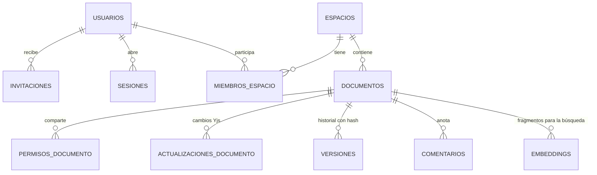

# editor-ia-database: la base de datos de Cuaderno

Este repositorio es la **única fuente de verdad** del esquema de PostgreSQL de **Cuaderno**: las
migraciones SQL numeradas, el usuario de la aplicación con privilegios mínimos, las pruebas SQL y las
herramientas para levantar los servicios locales. El backend solo lo consume. La **guía completa para
evaluar el proyecto** (acceso, roles y la prueba de cada función paso a paso) está en el README
principal, en [editor-ia-backend](https://github.com/Jonar519/editor-ia-backend#readme).

## Contenido

1. [Qué es](#1-qué-es)
2. [Cómo funciona](#2-cómo-funciona)
3. [Tecnologías](#3-tecnologías)
4. [Qué se necesita](#4-qué-se-necesita)
5. [Acceso y roles](#5-acceso-y-roles)
6. [Guía de pruebas de la base](#6-guía-de-pruebas-de-la-base)
7. [Pruebas automatizadas](#7-pruebas-automatizadas)
8. [Limitaciones y decisiones de diseño](#8-limitaciones-y-decisiones-de-diseño)
9. [Solución de problemas](#9-solución-de-problemas)
10. [Estructura del repositorio](#10-estructura-del-repositorio)
11. [Glosario](#11-glosario)

## 1. Qué es

La base guarda las cuentas y su seguridad (invitaciones, sesiones, verificación en dos pasos,
auditoría), los espacios y documentos con sus permisos, el contenido colaborativo (cambios de Yjs,
versiones encadenadas por hash, comentarios), los embeddings de la búsqueda por significado y el uso
diario de la IA.

Además **protege las reglas por sí misma**: un espacio tiene un solo propietario, una cuenta de
Lectura no puede tener un rol mayor en ningún espacio, las versiones solo se insertan (nunca se
modifican) y la búsqueda solo devuelve fragmentos del espacio pedido y de documentos con acceso. El
backend se conecta con un usuario (`cuaderno_app`) que no es dueño de las tablas: no puede desactivar
triggers, cambiar el esquema ni reescribir el historial.

## 2. Cómo funciona

- **23 migraciones** (`migrations/0001_…sql` a `0023_…sql`), cada una en una transacción junto con su
  registro y su checksum en `schema_migrations`. Una migración aplicada no se edita.
- **Dos usuarios de base:** `cuaderno` (dueño de las tablas, solo para migraciones y pruebas) y
  `cuaderno_app` (el único con el que se conecta el backend).
- **Avisos en vivo:** cuando cambia algo que quita acceso (miembros, roles, sesiones, cuentas), la base
  emite un `NOTIFY` en el canal `cuaderno_permisos`, con solo ids, y el backend corta las conexiones
  afectadas.
- **Funciones de la base** para lo crítico: verificar la cadena de versiones, compactar el log de Yjs,
  eliminar una cuenta (lápida), buscar fragmentos y purgar por retención.



El modelo completo (contextos, agregados, diagrama entidad-relación y cada regla con su prueba y su
mutación) está en [docs/modelo-dominio.md](docs/modelo-dominio.md); el contenido de cada migración, en
la [referencia técnica](docs/referencia-tecnica.md#esquema).

## 3. Tecnologías

| Tecnología                       | Versión                                 | Para qué se usa                                                    | Por qué se eligió                                                                                     |
| -------------------------------- | --------------------------------------- | ------------------------------------------------------------------ | ----------------------------------------------------------------------------------------------------- |
| **PostgreSQL**                   | 16 (imagen `pgvector/pgvector:pg16`)    | Base de datos                                                      | Restricciones, exclusiones, triggers, funciones y `NOTIFY` para que las reglas no dependan del backend. |
| **pgvector** · **citext**        | extensiones                             | Embeddings de 1024 dimensiones · correos sin distinguir mayúsculas | Vectores en la misma base y correos únicos sin trucos.                                                |
| **Redis**                        | 7 (imagen `redis:7-alpine`)             | Lo usa el backend; aquí solo se levanta el contenedor               | El mismo `docker-compose.yml` levanta todo lo de desarrollo.                                          |
| **Node.js** + **pg**             | 24 o superior · 8.23.1                  | Runner de migraciones, pruebas SQL, huella y scripts               | Sin `psql` instalado: todo corre con Node y Docker.                                                   |
| **Vitest** · **TypeScript** · **ESLint** | 5.0.4 · 7.0.2 · 10.12.0         | Pruebas de las herramientas y revisión del código                  | Mismas herramientas que los otros repositorios.                                                       |
| **Docker Compose**               | —                                       | PostgreSQL (127.0.0.1:5435) y Redis (127.0.0.1:6381)               | Mismo entorno en cualquier equipo; gitleaks también corre en Docker.                                  |
| **GitHub Actions** · **gitleaks** | —                                      | CI: lint, tipos, pruebas, mutaciones, `npm audit` y secretos       | Cada `push` demuestra que el esquema y sus reglas se cumplen.                                         |
| **Railway**                      | —                                       | PostgreSQL con pgvector y Redis en producción                      | Mismo proyecto que el API y el servicio de IA.                                                        |

## 4. Qué se necesita

- **Para evaluar en producción:** nada de este repositorio; solo el navegador (ver
  [Qué necesita el profesor](https://github.com/Jonar519/editor-ia-backend#4-qué-necesita-el-profesor)).
- **Para levantar la base en local:** Docker Desktop (motor Linux) encendido y Node.js 24 o superior.
  No hace falta instalar `psql` ni `gitleaks`. En `cmd.exe`:

```bat
cd editor-ia-database
npm ci
scripts\db-up.bat
scripts\db-migrate.bat dev
```

Esperado: `db-up` crea `.env` con contraseñas locales aleatorias (o le agrega solo lo que falte, sin
cambiar nada), levanta `cuaderno_postgres` y `cuaderno_redis` y habilita el login de `cuaderno_app`;
la migración termina con `Base cuaderno: 23 migraciones aplicadas.` y
`scripts\db-migrate.bat dev --estado` muestra `23 aplicadas, 0 pendientes`. Las variables se generan
solas; su forma es, por ejemplo:

```ini
PGHOST=127.0.0.1
PGPORT=5435
PGUSER=cuaderno
CUADERNO_APP_PASSWORD=<generada por db-up>
```

Después sigue con el API y el frontend:
[opción local](https://github.com/Jonar519/editor-ia-backend#b-opción-local-opcional).

## 5. Acceso y roles

En la base, los permisos de cuenta son `admin`, `editor` y `lector`, y los roles de espacio
`propietario`, `editor` y `lector`; una regla de la base impide que el rol en un espacio supere el de
la cuenta. Cómo se entra a la aplicación, las invitaciones y la verificación en dos pasos:
[Acceso y roles](https://github.com/Jonar519/editor-ia-backend#5-acceso-y-roles).

## 6. Guía de pruebas de la base

Con la base local levantada (sección 4). Las funciones de la aplicación se prueban con la
[guía principal](https://github.com/Jonar519/editor-ia-backend#6-guía-de-pruebas-función-por-función).

| Función                        | Qué hace                                                  | Pasos para probarla                                    | Resultado esperado                                                                                                          |
| ------------------------------ | --------------------------------------------------------- | ------------------------------------------------------ | --------------------------------------------------------------------------------------------------------------------------- |
| Estado de las migraciones      | Muestra lo aplicado y lo pendiente, con una conexión de solo lectura | `scripts\db-migrate.bat dev --estado`        | `Base cuaderno: 23 aplicadas, 0 pendientes.`                                                                                 |
| Migraciones repetibles         | Aplica solo lo pendiente                                  | `scripts\db-migrate.bat dev` otra vez                  | No aplica nada nuevo.                                                                                                       |
| Pruebas de la base             | Intentan romper cada regla                                | `scripts\db-test.bat`                                  | Las pruebas de Vitest en verde y `Pruebas SQL: 198 OK, 0 fallidas`.                                                         |
| Huella de la base de desarrollo | Prueba que las pruebas no tocan tus datos               | `scripts\db-huella.bat tomar antes`, luego `scripts\db-test.bat` y `scripts\db-huella.bat comparar antes` | La huella (filas por tabla y hash del esquema) no cambia.                                    |
| Mutaciones de una regla        | Rompe una regla y exige que una prueba falle              | `scripts\mutar.bat K01`                                | `DETECTADA` con la primera prueba que falló.                                                                                |
| Modelo de dominio              | Documenta cada regla con su prueba y su mutación          | Abre [docs/modelo-dominio.md](docs/modelo-dominio.md)  | Contextos, diagrama ER, glosario y reglas.                                                                                 |

Demostraciones paso a paso de los primeros bloques: [docs/demo-A.md](docs/demo-A.md),
[docs/demo-B.md](docs/demo-B.md) y [docs/demo-C.md](docs/demo-C.md).

## 7. Pruebas automatizadas

| Comando              | Qué cubre                                                                                                                                       | Resultado esperado                                     |
| -------------------- | ----------------------------------------------------------------------------------------------------------------------------------------------- | ------------------------------------------------------ |
| `scripts\db-test.bat` | 74 pruebas de Vitest (unitarias y de integración contra Postgres real) y **198 pruebas SQL** (cada caso en su transacción con `ROLLBACK`)     | `Tests 74 passed (74)` y `Pruebas SQL: 198 OK, 0 fallidas`. |
| `scripts\mutar.bat`  | **173 mutaciones**: cada regla crítica rota a propósito; antes, una corrida base sin mutaciones tiene que pasar                                   | `Detectadas 170, sobreviven 0, equivalentes 3` (las equivalentes se informan aparte). |
| `scripts\ci.bat`     | Lint, typecheck, pruebas, mutaciones, `npm audit` y gitleaks                                                                                     | `RESULTADO: OK`.                                       |

Por seguridad, ninguna operación destructiva acepta un nombre de base que no termine en `_test`.

## 8. Limitaciones y decisiones de diseño

- **`compactar_documento()` es `SECURITY DEFINER`:** corre como el dueño de las tablas. En producción
  ese dueño debe ser un rol sin superusuario.
- **La contraseña de PostgreSQL se fija al crear el volumen:** si borras `.env` y conservas el volumen,
  ya no coincide (ver [Solución de problemas](#9-solución-de-problemas)).
- **Sin seed de datos de ejemplo:** las cuentas nacen solo por invitación, también en desarrollo
  (`scripts\invitar.bat` del backend).
- **La tabla de rangos de IP para la ubicación aproximada empieza vacía:** sin datos, las sesiones
  aparecen sin ubicación.
- **Las migraciones no corren solas en producción:** se aplican con el mismo runner antes de desplegar
  el backend.

## 9. Solución de problemas

| Síntoma                                                     | Qué hacer                                                                                                                                         |
| ----------------------------------------------------------- | ------------------------------------------------------------------------------------------------------------------------------------------------- |
| `db-up.bat` falla: puerto 5435 o 6381 ocupado               | Otro servicio usa el puerto: detenlo.                                                                                                             |
| La autenticación falla después de borrar `.env`             | Recupera el `.env` anterior, o recrea la base con `docker compose down -v` (**borra los datos locales**) y vuelve a correr `db-up` y la migración. |
| Las pruebas dicen que la base no es de pruebas              | A propósito: las operaciones destructivas solo aceptan bases que terminan en `_test`.                                                             |
| `ABORTADO: las pruebas fallan SIN mutaciones`               | Las mutaciones no miden nada si la base falla: corre `scripts\db-test.bat`, corrige y repite.                                                     |
| Docker no responde                                          | Enciende Docker Desktop con el motor Linux y espera a que esté listo.                                                                            |

## 10. Estructura del repositorio

```
editor-ia-database/
├── migrations/          # 0001 … 0023 y sus reglas (migrations/README.md)
├── tests/
│   ├── sql/             # pruebas SQL (*.test.sql) y sus apoyos (_*.sql)
│   ├── unitarias/       # pruebas de las herramientas
│   └── integracion/     # pruebas contra Postgres real, en bases *_test temporales
├── mutations/           # catálogo de mutaciones
├── scripts/             # db-up, db-down, db-migrate, db-test, db-huella, mutar, gitleaks, ci
├── docs/
│   ├── modelo-dominio.md      # contextos, agregados, diagrama ER, glosario y reglas
│   ├── referencia-tecnica.md  # servicios, scripts, cada migración, usuario de la app y pruebas
│   └── demo-A/B/C.md          # demostraciones de los primeros bloques
└── docker-compose.yml   # PostgreSQL 16 + pgvector y Redis 7
```

## 11. Glosario

| Término                          | Qué significa aquí                                                                                       |
| -------------------------------- | -------------------------------------------------------------------------------------------------------- |
| **Migración**                    | Archivo SQL numerado que cambia el esquema; se aplica una vez y queda registrado con su checksum.        |
| **Privilegios mínimos**          | El usuario de la app solo puede lo que necesita; no es dueño de las tablas.                              |
| **Trigger**                      | Función que la base ejecuta sola al insertar o cambiar filas.                                            |
| **SECURITY DEFINER**             | Función que corre con los permisos de su dueño y no de quien la llama.                                   |
| **NOTIFY**                       | Aviso de PostgreSQL a los procesos que escuchan un canal.                                                |
| **Lápida**                       | Cuenta eliminada que conserva su id (para la autoría) y pierde sus datos personales.                    |
| **Cadena de hash**               | Cada versión guarda el hash de la anterior; alterar una rompe la cadena.                                  |
| **Huella**                       | Resumen de solo lectura (filas por tabla y hash del esquema) para comprobar que algo no cambió.          |

El glosario completo del proyecto está en el
[README principal](https://github.com/Jonar519/editor-ia-backend#11-glosario).
