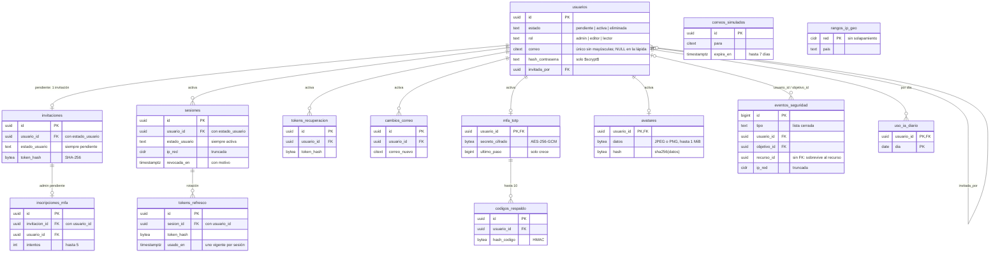
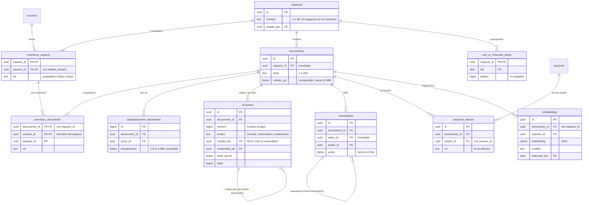

# Modelo de dominio de Cuaderno

Este documento reúne en un solo lugar lo que antes estaba en `esquema-identidad.md` (migraciones 0002–0007, 0014–0020) y `esquema-dominio.md` (0008–0011, 0021):
- los **contextos** del dominio;
- los **agregados**;
- cada **invariante** con **dónde se aplica** y **cuál es su prueba**;
- el **diagrama ER**;
- un **glosario**.

Cubre las migraciones 0001–0023.

**La idea central:** las reglas viven **en la base**, no solo en el backend. Aunque el backend tenga un error, la base rechaza el estado inválido. El API es la primera línea (da mensajes claros y códigos HTTP) y la base es la última.

## Cómo leer las tablas de invariantes

**Dónde se aplica:**

| Mecanismo | Qué es |
|---|---|
| **Restricción** | `CHECK`, clave foránea (también compuesta), `UNIQUE` o `EXCLUDE`. La base la evalúa en cada fila. |
| **Trigger** | Un trigger o función de la base. Incluye los *constraint triggers* diferidos, que se revisan al `COMMIT`. |
| **Rol** | Privilegios del rol de la aplicación `cuaderno_app` (0012): lo que la app no puede hacer aunque lo intente. |
| **API** | Lo aplica solo el backend (editor-ia-backend), o el backend además de la base. |

**Prueba y mutación:**
- **Prueba:** el archivo donde está el caso. `sql/00NN` es `tests/sql/00NN_*.test.sql`, que corre con `npm run test:sql`. `integración` es `tests/integracion/*.test.mjs`.
- **Mutación:** el id en `mutations/catalogo.json` de este repo. Quita la regla, y alguna prueba tiene que fallar (`scripts\mutar.bat <id>`).
  - **(equiv.)** marca una mutación **equivalente**: quitar esa línea no cambia nada porque otra regla ya lo impide. Se conserva como defensa en profundidad.
- **back** antes de un id es el catálogo de mutaciones del backend.
- **Sin mutación** o **sin caso** se declaran tal cual.

## Contextos

| Contexto | Qué resuelve | Tablas |
|---|---|---|
| **Identidad y acceso** | Quién es la persona, cómo entra y cómo sale | `usuarios`, `invitaciones`, `inscripciones_mfa`, `sesiones`, `tokens_refresco`, `tokens_recuperacion`, `cambios_correo`, `mfa_totp`, `codigos_respaldo`, `avatares` |
| **Colaboración** | Quién puede qué sobre qué: espacios, miembros, documentos y permisos | `espacios`, `miembros_espacio`, `documentos`, `permisos_documento` |
| **Contenido e historial** | El texto del documento y su historia: log Yjs, versiones, comentarios y presencia | `actualizaciones_documento`, `versiones`, `comentarios`, `sesiones_edicion` (más `documentos.estado_yjs`) |
| **IA** | Búsqueda semántica aislada por espacio, y consumo | `embeddings`, `uso_ia_diario`, `uso_ia_indexado_diario` |
| **Auditoría y operación** | Rastro de seguridad, retención, apoyo de la demo y migraciones | `eventos_seguridad`, `correos_simulados`, `rangos_ip_geo`, `schema_migrations` |

**Cómo se relacionan:**
- **Identidad → todos.** El único concepto que exporta es la **cuenta activa**. Las demás tablas la exigen con un `CHECK (estado_usuario = …)` más una clave foránea compuesta a `usuarios (id, estado)`, o por una cadena de claves foráneas.
- **Colaboración → Contenido e IA.** Exporta el **rol efectivo** (`rol_efectivo_documento`). Escribir, comentar, registrar presencia, indexar y buscar lo consultan **en la base**.
- **Auditoría** solo escucha y registra: no decide permisos. Los **avisos** (`NOTIFY cuaderno_permisos`) salen de Identidad y de Colaboración hacia el backend, que corta las conexiones en tiempo real.

## Diagrama ER

Dos diagramas por legibilidad. Solo muestran claves y columnas que definen relaciones o reglas; las columnas de fecha y de datos van en las tablas de invariantes.

### Identidad, auditoría y operación



### Colaboración, contenido e IA



## Agregados

Un agregado es lo que cambia junto y se protege junto: su **raíz** es la fila por la que se entra, y sus reglas se cumplen al terminar cada transacción.

| Agregado | Raíz | Entidades | Qué protege | Cómo termina |
|---|---|---|---|---|
| **Cuenta** | `usuarios` | `mfa_totp`, `codigos_respaldo`, `avatares`, `tokens_recuperacion`, `cambios_correo`, `uso_ia_diario` | El ciclo de vida (pendiente → activa → lápida) y que solo una cuenta activa tenga credenciales | Pendiente: `DELETE` (cancelar). Activa: `eliminar_cuenta()` la deja como lápida. Nunca se borra una cuenta activa. |
| **Invitación** | `invitaciones` | `inscripciones_mfa` | Alta solo por invitación, de un solo uso, 72 h | Se consume al completar (se borra antes de activar), se cancela o vence (retención) |
| **Sesión** | `sesiones` | `tokens_refresco` | Una sesión viva por login; rotación con un refresh vigente | Revocación con motivo; la retención la borra 30 días después de terminar |
| **Espacio** | `espacios` | `miembros_espacio`, `uso_ia_indexado_diario` | Exactamente un propietario; solo cuentas activas como miembros | `DELETE` en cascada con sus documentos (el backend solo lo permite si queda un solo miembro) |
| **Documento** | `documentos` | `permisos_documento`, `actualizaciones_documento`, `versiones`, `comentarios`, `sesiones_edicion`, `embeddings` | Exactamente un propietario; un lector nunca escribe; historial de solo inserción y encadenado; aislamiento de la IA | `DELETE` en cascada (la única forma de que desaparezcan sus versiones) |
| **Evento de seguridad** | `eventos_seguridad` | — | Solo inserción, sin texto libre | Retención (180 días); solo se anonimiza |

**Entre agregados se apunta por id, con claves foráneas compuestas** para que la referencia no pueda mentir:
- `permisos_documento → miembros_espacio`: el permiso es de alguien que **es** miembro.
- `embeddings → documentos (id, espacio_id)`: el fragmento está en el espacio **real** de su documento.
- `sesiones_edicion → sesiones (id, usuario_id)`: la presencia cuelga de una sesión de login **de esa misma cuenta**.

## Rol efectivo

`rol_efectivo_documento(usuario, documento)` es la única respuesta a «¿qué puede hacer esta cuenta con este documento?». Devuelve `propietario`, `editor`, `lector` o `NULL` (sin acceso).
- La usan los triggers de la base (escribir, versionar, comentar, presencia, indexar y buscar).
- La usa el backend: en cada pedido (`src/contenido/acceso.ts`) y al entrar al WebSocket.

| Situación | Rol efectivo |
|---|---|
| Propietario del documento | `propietario` |
| Propietario del espacio, sin permiso propio en el documento | `editor` (ser dueño del espacio no da la propiedad del documento) |
| Editor del espacio | `editor` |
| Lector del espacio con permiso `editor` en el documento | `editor` (solo en ese documento) |
| Lector del espacio | `lector` |
| No es miembro del espacio | `NULL` |
| Cuenta con rol de cuenta `lector` | nunca pasa de `lector` |

El rol de cuenta `admin` administra cuentas e invitaciones. **No** da acceso al contenido de los documentos.

## Invariantes

### Identidad: ciclo de vida de la cuenta

```
            invitación (admin)            completar registro                 eliminar cuenta
  (nada) ─────────────────────▶ pendiente ──────────────────▶ activa ──────────────────▶ eliminada (lápida)
                                   │ sin contraseña              contraseña                 sin correo, nombre,
                                   │ solo puede tener            (+ MFA si es admin)        teléfono ni contraseña
                                   │ su invitación               sesiones y tokens
                                   └─ cancelar = DELETE (solo pendientes)
```

| Invariante | Dónde se aplica | Prueba | Mutación |
|---|---|---|---|
| Toda cuenta nace pendiente (no hay alta directa de cuentas activas) | Trigger `usuarios_nacen_pendientes` (0002) | sql/0002 | B13 |
| Transiciones: solo pendiente → activa y activa → eliminada | Trigger `usuarios_transicion_estado` (0002) | sql/0002 | B14 |
| Una cuenta pendiente no tiene contraseña | Restricción `usuarios_pendiente_sin_contrasena` | sql/0002 | B15 |
| Una cuenta activa tiene contraseña y fecha de activación | Restricción `usuarios_activa_completa` | sql/0002 | B16 |
| La eliminada es una lápida sin datos personales | Restricción `usuarios_eliminada_es_lapida` | sql/0002 | B17 |
| La contraseña solo se guarda como hash `$scrypt$…` | Restricción `usuarios_hash_scrypt`; API: scrypt con costo 15+ en producción (back E33) | sql/0002 | B18 |
| Correo único sin distinguir mayúsculas; una lápida libera el correo | Restricción: índice único parcial sobre `citext` | sql/0002 | B19 |
| Solo un admin activo invita | Trigger `usuarios_invitada_por_admin`; API: solo un admin invita (back E24) | sql/0002 | B20 |
| Solo se borran cuentas pendientes (las demás se anonimizan) | Trigger `usuarios_solo_se_borran_pendientes` | sql/0002 | B21 |
| `creado_en` lo fija la base (no se fabrican plazos más largos) | Trigger: función `fijar_creado_en` | sql/0002 | B22 |
| Token usado, sesión revocada o MFA confirmado no se deshacen | Trigger: función `una_sola_vez` | sql/0002 | B23 |
| Los plazos solo se acortan | Trigger: función `plazos_solo_se_acortan` | sql/0002 | B24 |
| Un admin activo siempre tiene MFA confirmado | Trigger de restricción diferido al `COMMIT` (0006) | sql/0006 | B38 |
| Una lectora no conserva roles que escriben (bajar a lector exige quitarlos) | Trigger `usuarios_lector_sin_roles_de_escritura` (0009) | sql/0009 | C31 |

### Identidad: credenciales solo de cuentas en el estado correcto

Cada tabla de sesión o token lleva una columna `estado_usuario` con dos reglas. **Juntas** solo admiten una cuenta que esté en ese estado **ahora mismo**:
- un **`CHECK (estado_usuario = 'activa')`**: sin él, una fila podría declararse `'pendiente'` y la clave foránea la aceptaría;
- una **clave foránea compuesta** `(usuario_id, estado_usuario) → usuarios (id, estado)`: sin ella, una fila que dice `'activa'` podría apuntar a una cuenta pendiente.

La clave foránea no se actualiza en cascada. Por eso una cuenta no cambia de estado mientras tenga esas filas: antes de anonimizarla se borran.

Las invitaciones usan el mismo mecanismo al revés (`'pendiente'`). Activar la cuenta exige borrar antes la invitación, así que **el enlace es de un solo uso por construcción**.

| Invariante | Dónde se aplica | Prueba | Mutación |
|---|---|---|---|
| Invitación solo de una cuenta pendiente | Restricciones: CHECK y FK compuesta (0003) | sql/0003 | B01, B02 |
| Sesión solo de una cuenta activa | Restricciones: CHECK y FK compuesta (0004) | sql/0004 | B03, B04 |
| Recuperación solo de una cuenta activa | Restricciones (0005) | sql/0005 | B05, B06 |
| Cambio de correo solo de una cuenta activa | Restricciones (0005) | sql/0005 | B07, B08 |
| MFA solo de una cuenta activa | Restricciones (0006) | sql/0006 | B09, B10 |
| Avatar solo de una cuenta activa | Restricciones (0017) | sql/0017 | G01, G02 |
| Membresía solo de una cuenta activa | Restricciones (0008); API: 404 genérico si la cuenta no está activa (back W09) | sql/0008 | C39, C40 |
| Refresh ligado a su sesión y al mismo usuario (transitivo: la sesión exige cuenta activa) | Restricción: FK compuesta `(sesion_id, usuario_id) → sesiones` | sql/0004 | B12 |
| Códigos de respaldo ligados al MFA (transitivo) | Restricción: FK a `mfa_totp` | sql/0006 | B11 |
| Inscripción MFA previa solo para admin pendiente, de ESA invitación | Trigger y restricciones (0014): solo admin; CHECK pendiente; FK compuesta a la invitación. La FK a la cuenta pendiente es **equivalente**, porque la cadena invitación → cuenta pendiente ya lo garantiza | sql/0014 | F01, F03, F05; F04 (equiv.) |

En `tokens_refresco` y `codigos_respaldo` no se repite el CHECK + FK a `usuarios` a propósito: la cadena ya lo impide, y la mutación sería equivalente.

### Identidad: tokens, sesiones y MFA

| Invariante | Dónde se aplica | Prueba | Mutación |
|---|---|---|---|
| Los tokens se guardan como SHA-256 (32 bytes), nunca en claro | Restricción por tabla | sql/0003 (representativa) | B26 |
| Invitación: 72 h como máximo | Restricción (0003); API: vencimiento calculado por la base (back E25, E34) | sql/0003 | B25 |
| Sesión: 30 días como máximo | Restricción (0004) | sql/0004 | B27 |
| Revocación de sesión con motivo válido | Restricción (0004) | sql/0004 | B28 |
| IP truncada: `/24` en IPv4, `/48` en IPv6 (sesiones y eventos) | Restricción + tipo `cidr` | sql/0004, sql/0015 | B29, F13 |
| Como máximo un refresh vigente por sesión (rotación) | Restricción `EXCLUDE` parcial (0013); API: reutilizar revoca la familia (back E07–E09) | sql/0004 | B30 |
| No se emite refresh para una sesión revocada | Trigger (0004) | sql/0004 | B31 |
| Recuperación: 15 min como máximo y una vigente por cuenta | Restricción CHECK + `EXCLUDE` (0013); API: pedir otra invalida la anterior (back G21) | sql/0005 | B32, B33 |
| Cambio de correo: uno pendiente por cuenta | Restricción `EXCLUDE` (0013) | sql/0005 | B41 |
| Anti-replay TOTP: `ultimo_paso` solo crece, y solo se evalúa cuando el UPDATE toca esa columna | Trigger `mfa_totp_anti_replay` (0006, corregido en 0016); API: UPDATE condicional (back G05, G06) | sql/0006, sql/0016 | B34, F15 |
| Secreto MFA inmutable (reconfigurar es borrar y crear) | Trigger `una_sola_vez` | sql/0006, sql/0014 | B35, F07 |
| AES-256-GCM: IV de 12 bytes y etiqueta de 16 | Restricción (0006) | sql/0006 | B36 |
| Como máximo 10 códigos de respaldo | Trigger con bloqueo de fila (0006) | sql/0006 | B37 |
| Inscripción MFA: nunca vence después que su invitación; como máximo 5 intentos | Restricción y trigger (0014); API: al quinto fallo se reinicia (back G15) | sql/0014 | F02, F06 |
| Avatar: firma JPEG `FF D8 FF` o PNG; nada después del fin del JPEG; 1 MiB; 1 a 4096 px; `hash = sha256(datos)` | Restricciones (0017); API: limpieza por lista blanca (back U01–U11) | sql/0017 | G03–G08 |

### Colaboración: espacios, documentos y permisos

| Invariante | Dónde se aplica | Prueba | Mutación |
|---|---|---|---|
| Exactamente un propietario por espacio | Restricción `EXCLUDE` parcial (0013) + trigger de restricción diferido `espacios_con_propietario` (0008); API: la propiedad se transfiere, no se quita (back W10, W14) | sql/0008 | C37, C38 |
| Exactamente un propietario por documento | Restricción `EXCLUDE` parcial (0013) + trigger diferido `documentos_con_propietario` (0009); API: transferir deja al anterior como editor (back W21) | sql/0009 | C32, C33 |
| Un permiso de documento solo para miembros del espacio del documento | Restricción: FK compuesta `permisos_documento_solo_miembros` | sql/0009 | C24 |
| El permiso declara el espacio real del documento | Restricción: FK compuesta `permisos_documento_del_documento` | sql/0009 | C25 |
| Sacar a alguien del espacio borra sus permisos de documento | Restricción: `ON DELETE CASCADE` de la FK compuesta | sql/0009 | — (sin mutación propia) |
| Solo un editor o propietario del espacio crea documentos | Trigger `documentos_creador_puede_escribir`; API: 403 claro (back W04) | sql/0009 | C34 |
| Un documento no cambia de espacio | Trigger `documentos_espacio_inmutable` | sql/0009 | C35 |
| Techo por rol de cuenta: una cuenta lectora solo recibe rol lector | Triggers `*_techo_rol_cuenta` (0008, 0009); API: 409 `rol_excede_cuenta` (back W08) | sql/0008 | C30 |
| Rol efectivo: sin membresía no hay acceso | Trigger: función `rol_efectivo_documento`; API: 404 igual que «no existe» (back W05, W06) | sql/0009 | C26 |
| Rol efectivo: una cuenta lectora queda en lector aunque se salten el techo | Función (segunda capa) | sql/0009 | C27 |
| Rol efectivo: ser propietario del espacio da `editor`, no `propietario` | Función | sql/0009 | C28 |
| Rol efectivo: solo cuentas activas | Función. **Equivalente:** el JOIN con `miembros_espacio` ya lo garantiza | sql/0009 | C29 (equiv.) |
| Nombre de espacio de 1 a 80 y título de 1 a 200 caracteres, sin espacios en los extremos | Restricciones `espacios_nombre_formato`, `documentos_titulo_formato`; API: zod | sql/0008, sql/0009 | — (caso SQL sin mutación) |
| Quitar o cambiar un permiso o un rol de miembro avisa al `COMMIT` (`NOTIFY cuaderno_permisos`), y no avisa si se revierte | Trigger (0009) | integración `avisos-permisos` | C36 |

### Contenido: escritura y log Yjs

| Invariante | Dónde se aplica | Prueba | Mutación |
|---|---|---|---|
| Insertar una actualización Yjs exige rol efectivo editor o propietario | Trigger `actualizaciones_exigen_escritura`; API: el guardia del WebSocket la descarta antes (back T01, T08) | sql/0010 | C10, C11 |
| Las actualizaciones no se reescriben | Trigger `actualizaciones_inmutables` + **rol**: la app no tiene `UPDATE` | sql/0010, sql/0012 | D02 |
| Una actualización mide de 1 B a 1 MiB | Restricción `actualizaciones_tamano`; API: cierre 1009 (sin prueba propia en el backend) | — | — (sin caso ni mutación) |
| El estado compactado mide hasta 10 MiB | Restricción `documentos_estado_tamano`; API: cierre 4413 (sin prueba propia en el backend) | — | — (sin caso ni mutación) |
| La app no borra actualizaciones por su cuenta: solo `compactar_documento()`, que escribe el estado y borra en la misma llamada | Rol: `REVOKE DELETE` (0021) + función | sql/0021 | K01, K04 |
| Compactar borra solo filas de ese documento, hasta `hasta_id`; las que llegan mientras tanto se quedan | Trigger: función `compactar_documento` | sql/0021 | K02, K03 |
| Sin estado vacío y con un `hasta_id` vigente de ese documento | Función | sql/0021 | K05, K06; K10 (equiv.: la comprobación de existencia ya rechaza NULL con el mismo SQLSTATE) |
| `SECURITY DEFINER` con `search_path` fijo; solo la ejecuta `cuaderno_app` | Función + rol | sql/0021 | K07, K08, K09 |
| Una compactación vieja no pisa a una nueva: bloquea el documento antes de comprobar, y con `NO KEY` (insertar cambios nuevos no se bloquea) | Función (`FOR NO KEY UPDATE`) | integración `compactar-concurrencia` | K11, K12 |

**La base no puede leer Yjs:** no comprueba que el estado compactado contenga lo que se borra. Eso lo hace el backend antes de llamar (ADR 0003 del backend).

### Contenido: historial de versiones

| Invariante | Dónde se aplica | Prueba | Mutación |
|---|---|---|---|
| Solo inserción: `UPDATE` y `DELETE` dan `42501` | Trigger `versiones_solo_insercion` + **rol**: la app no tiene esos privilegios | sql/0010, sql/0012 | C01, D01 |
| `TRUNCATE` prohibido | Trigger `versiones_sin_truncate` | sql/0010 | C02 |
| Una versión solo desaparece junto con su documento | Trigger (excepción acotada) | sql/0010 | C03 |
| La base numera; el cliente no elige número, hashes ni fecha | Trigger `versiones_encadenar` | sql/0010 | C06 |
| Cada versión encadena el hash de la anterior, y el hash cubre el contenido | Trigger `versiones_encadenar` | sql/0010 | C04, C05 |
| La verificación recalcula cada hash y comprueba cada eslabón | Función `verificar_cadena_versiones`; API: «Verificar la cadena» en la interfaz (back R01–R03) | sql/0010; integración del backend con el dueño de la base | C07, C08 |
| Crear una versión manual o una restauración exige escritura | Trigger; API: editor o propietario (back N01, N02) | sql/0010 | C09 |
| Las automáticas no tienen autor; las manuales y las restauraciones sí | Restricción `versiones_autor_segun_motivo` | sql/0010 | C13 |
| Solo se restaura desde una versión del mismo documento | Restricción: FK compuesta `versiones_restaura_su_documento` | sql/0010 | C12 |
| El estado de una versión mide hasta 10 MiB | Restricción `versiones_estado_tamano` | — | — (sin caso ni mutación) |

```
hash = SHA-256( hash_previo ‖ documento ‖ número ‖ SHA-256(estado Yjs) ‖ SHA-256(texto) ‖ autor ‖ motivo ‖ restaurada_de ‖ creado_en )
```

La primera versión parte de 32 bytes en cero.

**Las pruebas manipulan una versión de verdad:** desactivan el trigger, como podría hacerlo un superusuario, cambian la versión y comprueban dos casos:
- si solo se cambia el texto, se detecta esa versión;
- si además se rehace su hash, se detecta el eslabón siguiente.

**Las versiones no tienen tope ni retención:** riesgo R-02 del backend, aceptado con monitoreo para el despliegue.

### Contenido: comentarios y presencia

| Invariante | Dónde se aplica | Prueba | Mutación |
|---|---|---|---|
| Comentar exige acceso (un lector comenta; un externo no) | Trigger `comentarios_exigen_acceso` | sql/0010 | C14 |
| Una respuesta pertenece al documento de su hilo y no lleva ancla propia | Restricciones: FK compuesta `comentarios_responde_su_documento` y CHECK `comentarios_ancla_solo_en_hilo` | sql/0010 | C15 |
| El autor de un comentario no cambia; cuerpo de 1 a 5000 caracteres | Trigger `comentarios_autor_inmutable` y restricción de longitud | sql/0010 | — (caso SQL sin mutación) |
| La sesión de edición registra exactamente el rol efectivo | Trigger `sesiones_edicion_validar` | sql/0010 | C16 |
| La sesión de edición exige una sesión de login viva, de la misma cuenta; cerrar la sesión de login la borra | Trigger + FK compuesta con cascada | sql/0010 | C17, C18 |

### IA: aislamiento garantizado por la base

| Invariante | Dónde se aplica | Prueba | Mutación |
|---|---|---|---|
| Nadie indexa contenido de un documento al que no tiene acceso, al insertar ni al actualizar | Trigger `embeddings_aislamiento`; API: el trabajo reverifica el acceso (back P21) | sql/0011 | C19, C21 |
| Un fragmento está en el espacio real de su documento | Restricción: FK compuesta `embeddings_mismo_espacio_que_documento` | sql/0011 | C20 |
| La búsqueda filtra por espacio y por el acceso **de hoy** de quien busca | Función `buscar_fragmentos` (0011 y 0023); API: ser miembro del espacio, o 404 (back P19) | sql/0011, sql/0023 | C22, C23, P04 |
| Solo se comparan vectores del modelo pedido, dentro del umbral, y como máximo N por documento | Función `buscar_fragmentos` (0023) | sql/0023 | P01, P02, P03 |
| Dimensión fija de 1024 y un fragmento único por documento | Restricción: tipo `vector(1024)` y `UNIQUE`; API: un vector de otra dimensión se rechaza (back P08, P31) | sql/0011 | — (caso SQL; la mutación está en el backend) |
| Contadores de uso no negativos: por espacio (indexado) y por cuenta | Restricciones `uso_ia_indexado_tokens_no_negativos` y `uso_ia_contadores_no_negativos`; API: los topes con UPDATE condicional y reserva atómica (back P15, P16, P37) | sql/0023, sql/0011 | P08 (por espacio); por cuenta, caso SQL sin mutación |
| El presupuesto del indexado se va en cascada con el espacio, y la app tiene sus privilegios | Restricción y rol (0023) | sql/0023 | P09, P10 |

### Auditoría, retención y privilegios

| Invariante | Dónde se aplica | Prueba | Mutación |
|---|---|---|---|
| Tipo de evento de una lista cerrada (sin texto libre: no puede guardar tokens ni contraseñas) | Restricción `eventos_seguridad_tipo_valido` (vigente: 0022) | sql/0015, sql/0022 | F08 |
| Un evento solo se anonimiza (`usuario_id`, `ip_red` y `objetivo_id` a NULL); nunca se reasigna; `recurso_id` no se reescribe | Trigger (vigente: 0022) | sql/0015, sql/0022 | F09, K17 |
| Solo se borran eventos más antiguos que la retención; `TRUNCATE` prohibido | Trigger (0015, 0022) | sql/0015 | F10, F11 |
| La app solo puede actualizar `usuario_id` e `ip_red` | Rol: privilegio por columna | sql/0015 | F12 |
| Borrar una cuenta pendiente anonimiza sus eventos; una lápida deja de ser objetivo identificable | Restricción `ON DELETE SET NULL` y trigger `usuarios_anonimizar_objetivo` | sql/0015, sql/0022 | F14, K16 |
| Revocar o borrar una sesión viva, desactivar una cuenta o cambiar su rol, y borrar un documento, avisan al `COMMIT` | Triggers `*_avisar_*` (0022) | integración `avisos-permisos` | K13, K14, K15 |
| `eliminar_cuenta()`: 409 (`CU409`) si es propietaria de documentos con colaboradores o de espacios con otros miembros; borra lo que no tiene colaboradores; anonimiza sus eventos (cuenta e IP); borra su uso de IA; solo una cuenta activa | Función (0018); API: 409 con la lista (back U30) | sql/0018 | G09–G15 |
| Retención: sesiones terminadas hace más de 30 días (la revocada cuenta desde la revocación); tokens vencidos hace más de 1 día; correos simulados al vencer; eventos de más de 180 días; uso de IA de más de 400 días | Función `purgar_retencion()` (vigente: 0023); API: job diario a las 03:15 UTC (back U32–U34) | sql/0019, sql/0023 | G16–G20, P05–P07 |
| Retención: cuentas pendientes con la invitación vencida hace más de 7 días, con lo que cuelga de ellas; una recién creada no se toca | Función `purgar_retencion()` (vigente: 0023) | sql/0020 | G21, G22, G23 |
| Correo simulado: 7 días como máximo | Restricción (0007) | sql/0007 | B39 |
| Rangos IP → ubicación sin solapamiento | Restricción `EXCLUDE USING gist` (0007) | sql/0007 | B40 |
| La app solo lee `schema_migrations` | Rol (0012) | sql/0012 | D03 |
| La app no tiene atributos privilegiados, no desactiva triggers, no cambia el esquema ni vacía tablas | Rol (0012); API: producción aborta con privilegios de más (back S22–S24) | sql/0012 | — (caso SQL; la mutación está en el backend) |
| Toda tabla tiene privilegios definidos para la app (una tabla nueva sin `GRANT` falla) | Rol (0012) | sql/0012 | D04 |

**Sin documentos huérfanos, por construcción.** Todo documento tiene exactamente un propietario, revisado al `COMMIT`. El propietario es miembro del espacio, y solo una cuenta activa puede ser miembro. Por eso una lápida no puede ser propietaria de nada. El historial de otros documentos sigue apuntando al id de la lápida, que no cambia: la cadena de hash se sigue verificando (prueba de sql/0018).

## Lo que aplica solo el API (la base no lo sabe)

Son reglas de comportamiento o de ritmo, no de estado. La base no tiene cómo verlas, o no le corresponden.

| Regla | Dónde (backend) | Mutación |
|---|---|---|
| Bloqueo progresivo por cuenta y límites de intentos (la base solo exige `fallos_login >= 0`) | `src/auth/limites.ts`, `servicio.ts` | back E14–E19 |
| Límite general de 600 pedidos por minuto y cuenta (riesgo R-07) | `limiteGeneral` | back R08–R10 |
| Guardar o restaurar versiones: 30 por hora por cuenta; verificar la cadena: 10 por minuto | `src/versiones/rutas.ts` | back R03 (verificar). Guardar no tiene mutación: el corte en la versión 31 se midió en R4 (`almacenamiento-r.md` del backend) |
| La versión automática se crea solo si el texto cambió | `src/tiempo-real/compactacion.ts` | back N05 |
| Restaurar es un cambio nuevo que toca solo lo que difiere | `src/versiones/servicio.ts` | back N03, N04, N11 |
| Comentarios: edita quien lo escribió; resuelve quien abrió el hilo o un editor; borra quien lo escribió o el propietario del documento; el ancla son dos posiciones relativas | `src/comentarios/servicio.ts` | back N06–N09 |
| No se quita a quien posee documentos del espacio (409 con la lista); no se borra un espacio con otros miembros | `src/espacios/servicio.ts` | back W11, W13 |
| Solo el propietario borra un documento o da permisos | `src/documentos/servicio.ts` | back W18, W19 |
| Topes diarios de IA por cuenta y presupuesto por espacio (la base solo garantiza contadores no negativos) | `src/ia/` | back P15, P16, P36–P38 |
| El orden de un cambio de propiedad (bloquear la fila antes de comprobar el rol) | `src/espacios`, `src/documentos` | back W15 |

## Lo que no tiene prueba o mutación propia

- **Restricciones de tamaño** (`actualizaciones_tamano`, `documentos_estado_tamano` y `versiones_estado_tamano`): no hay caso SQL ni mutación. En el backend, el cierre 1009 y el 4413 tampoco tienen prueba propia (modelo de amenazas del backend).
- **Formato de nombres y títulos, cuerpo y autor de comentarios, cascada de permisos al sacar a un miembro:** tienen caso SQL, pero no mutación.
- **El `FOR UPDATE` de `eliminar_cuenta()`**, que impide que alguien se sume a un espacio entre la revisión y el borrado: es una carrera entre dos conexiones, y las pruebas SQL corren en una sola. Su mutación sería indetectable aquí.
- **Mutaciones equivalentes** (C29, F04 y K10): cada una se explica en su fila.

## Decisiones vigentes

- **El rol de espacio da acceso a todos los documentos del espacio.** No hay documentos privados dentro de un espacio. Si se quisieran, se agregaría un nivel «restringido» en una migración nueva.
- **Activación de un admin.** El MFA se crea en la misma transacción que la activación: primero el `UPDATE` a `activa`, después el `INSERT` en `mfa_totp`. Por eso la regla «un admin activo tiene MFA» es diferida.
- **Inscripción MFA de un admin pendiente** (`inscripciones_mfa`, 0014). Un admin pendiente no puede tener fila en `mfa_totp`. El secreto que ve antes de confirmar su primer código vive en esta tabla y se borra en cascada con su invitación, sea porque se completa, se cancela o se reenvía.
- **Correo simulado.** Guarda el cuerpo del correo con el enlace, porque es el «buzón» de la demo. Solo existe con el proveedor simulado (producción no arranca con él) y se borra a los 7 días como máximo.
- **La dimensión de los vectores es 1024.** Un proveedor con otra dimensión exige una migración nueva.
- **`documentos.actualizado_en`** es «último cambio de la fila» (el título o el estado compactado), no «última edición del texto»: compactar también lo mueve.
- **`buscar_fragmentos` de 4 parámetros** (0011) se conserva para el backend anterior a P2, porque el orden de despliegue es base primero. Se quita en una migración posterior.

## Notas de las migraciones que redefinen reglas

Cuando una migración reemplaza una función o una restricción, la mutación apunta a la **definición vigente**. Si siguiera mutando la vieja, sobreviviría sin que nada falle.

- **0013:** los «como máximo uno vigente» pasaron de índices únicos parciales a `EXCLUDE USING btree (…) WHERE (…)`.
  - Hacen lo mismo; la violación da `23P01` en lugar de `23505`.
  - El motivo: con índices únicos parciales, `prisma db pull` deducía relaciones uno a uno que no existen.
  - `invitaciones` y `mfa_totp`, que sí son uno a uno, llevan además un `UNIQUE (usuario_id, estado_usuario)` redundante, que es el que Prisma exige.
  - B30, B33, B41, C32 y C37 apuntan a 0013.
- **0016:** el anti-replay se disparaba en cualquier `UPDATE`, así que confirmar el MFA chocaba. Pasó a `BEFORE UPDATE OF ultimo_paso`.
- **0018 y 0022:** redefinen `eventos_seguridad_tipo_valido`. F08 apunta a 0022.
- **0020 y 0023:** reemplazan `purgar_retencion()` entera. G17 y G19–G23 apuntan a 0023.

## Glosario

| Término | Significado |
|---|---|
| **Cuenta** | Una fila de `usuarios`. Tiene un estado (pendiente, activa o eliminada) y un rol de cuenta. |
| **Cuenta pendiente** | Invitada y todavía sin contraseña. Solo puede tener su invitación (y su inscripción MFA, si es admin). |
| **Lápida** | Una cuenta eliminada: conserva su id para el historial, sin correo, nombre, teléfono ni contraseña. |
| **Rol de cuenta** | `admin`, `editor` o `lector`. Un admin administra cuentas, no contenido. Una cuenta lectora nunca escribe. |
| **Invitación** | El único camino para crear una cuenta. Vale 72 h, es de un solo uso y en la base solo queda el SHA-256 de su token. |
| **Inscripción MFA** | El secreto TOTP de un admin pendiente, antes de que confirme su primer código. |
| **Sesión** | Un inicio de sesión vivo, con su IP truncada, su vencimiento (30 días como máximo) y, si se revocó, un motivo. |
| **Refresh (token de refresco)** | Credencial que rota: cada uso emite otro, y reutilizar uno ya usado revoca la sesión. Las de una sesión son su **familia**. |
| **Anti-replay** | Un código TOTP solo vale si su paso es mayor que el último aceptado. |
| **Código de respaldo** | Uno de 10 códigos de un solo uso para entrar sin el teléfono. Se guarda solo su HMAC. |
| **Espacio** | Grupo de trabajo con miembros y documentos. Tiene exactamente un propietario. |
| **Rol de espacio** | `propietario`, `editor` o `lector` de un miembro. Da acceso a todos los documentos del espacio. |
| **Permiso de documento** | Un rol propio sobre un documento (propietario, o editor para subir a un lector). Solo para miembros del espacio. |
| **Rol efectivo** | Lo que una cuenta puede hacer con un documento, calculado por la base (`rol_efectivo_documento`). |
| **Propietario** | Quien posee un espacio o un documento. Siempre hay exactamente uno; la propiedad se **transfiere**, nunca se quita. |
| **Actualización (Yjs)** | Un cambio binario del CRDT, con autor. Se inserta, nunca se reescribe. |
| **Estado compactado** | `documentos.estado_yjs`: el documento con todas las actualizaciones hasta un punto ya aplicadas. |
| **Compactación** | Escribir el estado compactado y borrar las actualizaciones que incluye, en una sola llamada (`compactar_documento`). |
| **Versión** | Copia completa de un documento (estado y texto). Puede ser **manual**, **automática** (tras 5 minutos sin cambios, si el texto cambió) o **restauración** (apunta a la versión restaurada). |
| **Cadena de hash** | Cada versión guarda el hash de la anterior (`hash_previo`) y el suyo. Cambiar una versión rompe su hash o el **eslabón** siguiente. |
| **Comentario e hilo** | Un hilo es un comentario con **ancla** (dos posiciones relativas de Yjs). Las respuestas cuelgan del hilo y no llevan ancla. |
| **Sesión de edición (presencia)** | Una conexión de tiempo real a un documento, con el rol efectivo de ese momento. Cuelga de una sesión de login. |
| **Fragmento (embedding)** | Un trozo del texto de un documento con su vector de 1024 dimensiones, etiquetado con su espacio. |
| **Indexado** | Calcular y guardar los fragmentos de un documento. El **automático** gasta el **presupuesto del espacio**, no la cuota de la persona. |
| **Tope diario** | Pedidos y tokens de IA por cuenta y día UTC. Lo aplica el backend; la base garantiza contadores no negativos. |
| **Aviso** | `NOTIFY cuaderno_permisos` al `COMMIT` de todo lo que quita acceso, con solo ids. El backend lo reenvía para cortar conexiones. |
| **Evento de seguridad** | Registro de auditoría, de solo inserción, sin texto libre: tipo, cuenta, objetivo, recurso (solo su id) e IP truncada. |
| **Anonimizar** | Poner en NULL las columnas que identifican a una persona, sin borrar ni reasignar el evento. |
| **Retención** | `purgar_retencion()`: borra lo vencido, con plazos que fija la base y se miden con su reloj. |
| **IP truncada** | La red `/24` (IPv4) o `/48` (IPv6) en lugar de la dirección completa. |
| **`cuaderno_app`** | El rol con el que se conecta el backend: privilegios mínimos, sin atributos privilegiados. |
| **Correo simulado** | El «buzón» de la demo: correos del proveedor simulado, que vencen a los 7 días como máximo. |
